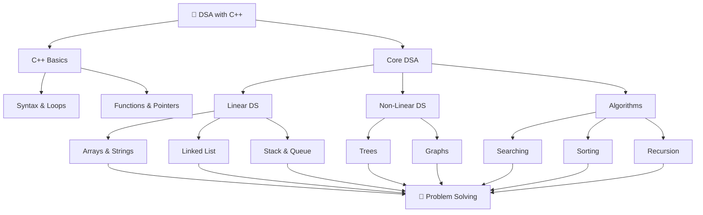

# 💻 Data Structures & Algorithms in C++

Welcome to my **Data Structures and Algorithms (DSA)** repository! 🚀

This repository contains my DSA learning journey and practice problems implemented using **C++**. It covers fundamental data structures, algorithms, and problem-solving techniques to improve logical thinking and programming skills.

## 🎯 Objectives

- Build a strong foundation in Data Structures and Algorithms.
- Understand important DSA concepts through practical implementation.
- Improve problem-solving and logical thinking.
- Practice writing efficient and optimized C++ code.
- Maintain a record of my learning and progress.

## 🗂️ Topics Covered

| Topic | Description |
|---|---|
| Basics of C++ | Syntax, loops, functions, and fundamentals |
| Arrays | Traversal, searching, and manipulation |
| Strings | String operations and problems |
| Searching | Linear Search, Binary Search |
| Sorting | Bubble, Selection, Insertion Sort |
| Recursion | Recursive functions and problems |
| Pointers | Memory addresses and pointer operations |
| Linked List | Singly and Doubly Linked Lists |
| Stack & Queue | Basic operations and implementation |
| Trees | Binary Trees and traversals |
| Graphs | Graph representation and traversal |
| Algorithms | Problem-solving techniques |

*Topics will be added as I continue learning and practicing.*

## 🔀 DSA Learning Roadmap

## 🛠️ Language & Tools

- **Language:** C++
- **IDE:** Visual Studio Code
- **Compiler:** GCC / G++
- **Version Control:** Git & GitHub

## 📈 Learning Progress

This repository is continuously updated with new concepts, practice questions, and solutions as I progress in my DSA journey.

## 👨‍💻 Author

**Sumit Kumar**

- GitHub: [@sumitkumar2374](https://github.com/sumitkumar2374)
- LinkedIn: [Connect with me](https://www.linkedin.com/)

---

⭐ If you find this repository helpful, consider giving it a star!

*Learning • Practicing • Improving 🚀*